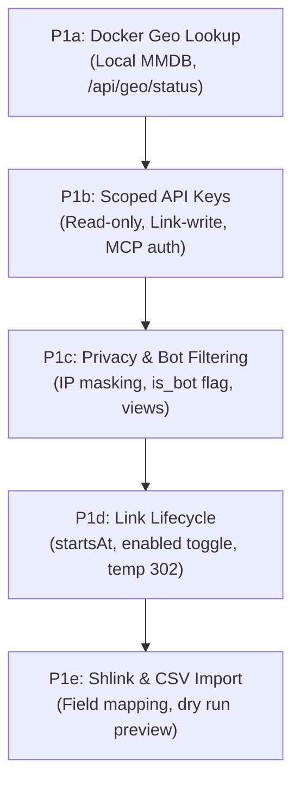

# Future Plan & Feature Roadmap

This document outlines the strategic roadmap and feature plan for Sink. It defines how Sink adopts the most valuable capabilities of modern URL management platforms (notably [Shlink](https://shlink.io)) while preserving Sink's lightweight, secure architecture: running either serverless on Cloudflare (Workers, D1, KV, Analytics Engine) or self-hosted on a single Docker host (Node.js, SQLite).

::: tip Product Principle: Keep Sink Lean
Sink is designed for zero operational friction. Features must run cleanly across both Cloudflare and single-container Docker environments without introducing heavyweight dependencies such as message brokers (RabbitMQ, Redis), external pub/sub engines, or sprawling relational database servers.
:::

---

## Strategic Summary

Sink's product roadmap is structured around three core themes:

1. **Keep Sink’s Current Strengths:** Built-in Model Context Protocol (MCP) server for AI agents, rich client-side QR generation, PBKDF2 link passwords, social graph previews (OpenGraph), tags, device and country routing, click webhooks, and zero-maintenance deployment.
2. **Phase 1 (Access, Control & Privacy):** Local IP geo resolution for Docker, scoped API keys for external applications and AI agents, privacy controls with IP masking, query-time bot filtering, scheduled and pauseable link lifecycles, and direct import from Shlink and CSV.
3. **Phase 2 & Beyond (Advanced Routing & Administration):** Ordered multi-condition redirect rules, missed visit (404) analytics, full tag lifecycle operations, and eventual multi-domain namespace partitioning for teams and brands.

---

## Current Strengths & Non-Goals

Before introducing new features, Sink defines clear architectural boundaries:

| Preserve in Sink                                                                                    | Non-Goals (Omit or Avoid)                                                                |
| :-------------------------------------------------------------------------------------------------- | :--------------------------------------------------------------------------------------- |
| **Model Context Protocol (MCP):** Native AI agent tool dispatch                                     | **External Message Brokers:** No RabbitMQ, Kafka, or Mercure SSE clusters                |
| **Client-Side QR Styling:** Flexible QR generation using `qr-code-styling` without server rendering | **Extra Database Engines:** No MySQL, MariaDB, or PostgreSQL bloat; retain D1 and SQLite |
| **Edge-First Storage:** Cloudflare D1 + KV read-through caching and local SQLite                    | **Email Tracking Pixels:** No 1-pixel tracking GIF endpoints                             |
| **Near-Realtime Polling:** 10-second polling queue rather than fragile persistent sockets           | **Full Website Proxying:** Single-request reverse proxy only; no HTML asset rewriting    |

---

## Feature Comparison Matrix

The table below contrasts Sink’s capabilities against Shlink, detailing current status and target implementation phases:

- **Present:** Fully supported in Sink source code.
- **Partial:** Sink implements a subset of the functionality.
- **Gap:** Planned capability not yet present in Sink’s reviewed routes and schemas.

| Capability             | Shlink Reference                                          |               Sink Status               | Target Phase | Implementation Details & Evidence                                                                                                 |
| :--------------------- | :-------------------------------------------------------- | :-------------------------------------: | :----------: | :-------------------------------------------------------------------------------------------------------------------------------- |
| **Core Links**         | Custom slugs, CRUD, search, pagination                    | Present |     Keep     | Supported via `shared/schemas/link.ts` and `/api/link/*`.                                                                         |
| **API Keys & Scopes**  | Multiple named keys, expiry, revocation, role scopes      |     Gap      | **Phase 1b** | Sink currently relies on a single admin token or Cloudflare Access. Scoped keys will add read-only and link-write tokens.         |
| **Link Timing**        | Start date, end date, max visits                          |   Partial    | **Phase 1d** | Sink currently supports expiration only. Planned additions include `startsAt` scheduling and pauseable states.                    |
| **Privacy Controls**   | IP anonymization/masking, disable IP/UA/referrer tracking |     Gap      | **Phase 1c** | Sink currently collects raw IP and User Agent. Privacy controls will add field-level collection toggles and CIDR masking.         |
| **Bot Analytics**      | Stored bot flag, filter bots at query time                |   Partial    | **Phase 1c** | Sink can drop bots during intake; planned support preserves bot records with an explicit flag and dashboard view filters.         |
| **Docker Geo Lookup**  | Built-in GeoLite2 local resolution                        | Present | **Phase 1a** | Implemented on `feat/standalone-docker` via local GeoLite2/GeoIP2 MMDB reader with automatic atomic updates.                      |
| **Import Sources**     | Import from Shlink, CSV, Bitly, YOURLS, Kutt              |   Partial    | **Phase 1e** | Sink supports custom JSON import. Planned additions include Shlink REST/file and standard CSV import adapters.                    |
| **Redirect Rules**     | Ordered rules: language, query, device, IP, geo           |   Partial    | **Phase 2a** | Sink currently has device and country overrides. Planned upgrade brings ordered multi-condition rules with first-match semantics. |
| **Tag Operations**     | Rename tags, delete tags, tag visit analytics             |   Partial    | **Phase 2b** | Sink supports tag assignment, listing, and filtering, but lacks bulk rename/delete endpoints and tag-scoped stats.                |
| **Missed Visits**      | Log 404 visits to invalid short codes and root            |     Gap      | **Phase 2b** | Sink logs resolved short codes only. Planned feature adds bounded circular/sampled tracking for failed short-link visits.         |
| **Fallback Redirects** | Route-specific and per-domain fallback targets            |   Partial    | **Phase 2b** | Sink provides global root and 404 fallbacks. Per-domain fallback policies will follow multi-domain support.                       |
| **Multi-Domain**       | Different destinations for the same slug across hosts     |     Gap      | **Phase 3**  | Sink currently keys links, caches, and tombstones globally by slug. Multi-domain requires compound keys (`domain + slug`).        |
| **Query Forwarding**   | Forward incoming query parameters to target               | Present |     Keep     | Implemented via `redirectWithQuery` link attribute.                                                                               |
| **Path Forwarding**    | Append subpaths after short code to destination           |     Gap      |    Later     | Low-priority enhancement; requires route validation to prevent conflicts with dashboard routes.                                   |
| **Nested Slugs**       | Multi-segment slugs (e.g., `/promo/summer`)               |     Gap      |    Later     | Requires adjusting slug regex validation and reserving core system paths (`/api/*`, `/dashboard/*`).                              |
| **Live Updates**       | SSE (Mercure), RabbitMQ, Redis Pub/Sub                    |   Partial    |     Keep     | Sink intentionally uses pseudo-live 10-second polling to avoid external server infrastructure.                                    |
| **QR Codes**           | Public server QR rendering endpoint                       | Present |     Keep     | Sink provides client-side styled QR rendering in the dashboard. Shlink deprecated its server endpoint in v4.5.                    |
| **Email Pixels**       | 1-pixel `/track` image endpoint                           |     Gap      |   **Skip**   | Excluded from roadmap. Out of scope for a dedicated link shortener.                                                               |
| **External Analytics** | Native Matomo visit streaming                             |     Gap      |    Later     | External analytics ingestion can be handled through Sink's async click webhooks.                                                  |

---

## Phased Implementation Plan

### Phase 1: Access Control, Privacy & Link Lifecycle

Phase 1 delivers the foundational upgrades needed for multi-client access, regulatory privacy compliance, and flexible campaign scheduling.

#### 1. Local Geo Lookup for Docker (Phase 1a)

- **Status:** Implemented locally on `feat/standalone-docker`.
- **Functionality:** Provides offline GeoIP2/GeoLite2 City and Country database resolution for Node/Docker environments, bringing parity with Cloudflare's edge geolocation.
- **Architecture:** Node-specific lookup behind `getRequestGeo(event)`, persistent volume storage, atomic reader swaps, and an authenticated `/api/geo/status` endpoint.

#### 2. Scoped API Keys for Apps and AI Agents (Phase 1b)

- **Status:** Planned.
- **Functionality:** Introduce multiple named API keys with expiration and revocation alongside the bootstrap site token.
- **Key Scopes:**
  - `read:links`: View links and search without mutating.
  - `write:links`: Create, update, and manage links.
  - `read:analytics`: Query click and location metrics.
- **Security:** Keys stored as cryptographic hashes (SHA-256). Single permission verification layer shared between standard REST routes and the MCP agent server.

#### 3. Privacy Controls & Bot Views (Phase 1c)

- **Status:** Planned.
- **Functionality:** Enable compliance with GDPR/ePrivacy regulations through runtime switches:
  - Toggle collection of client IP, Referer, and User-Agent headers.
  - Subnet IP anonymization (e.g., masking the final octet of IPv4 and prefixing IPv6) before persisting to storage.
  - Short-lived salt-keyed hashes for unique visitor estimation without storing persistent PII.
  - Explicit `is_bot` boolean stored on access records, enabling dashboard toggles to view All Visits, Human Visitors Only, or Automated Bots.

#### 4. Scheduled and Paused Link Lifecycle (Phase 1d)

- **Status:** Planned.
- **Functionality:** Expand link control beyond basic expiration:
  - `startsAt`: Schedule links to become active at a future timestamp.
  - `enabled`: Manual pause/resume toggle for operational suspension.
  - Lifecycle states: `Active`, `Scheduled`, `Paused`, and `Expired`.
  - HTTP Semantics: Dynamic and pending links issue non-permanent redirects (`302 Found` or `307 Temporary Redirect`) to prevent aggressive client and CDN caching prior to activation.

#### 5. Shlink & Extended CSV Import Adapters (Phase 1e)

- **Status:** Planned.
- **Functionality:** Simplify migrations into Sink:
  - Dedicated Shlink import adapter mapping short codes, destination URLs, tags, titles, creation dates, and expiration timestamps.
  - Standardized CSV import parser with customizable column mappings.
  - Interactive dry-run validator highlighting schema violations, reserved slugs, and duplicate conflicts prior to commit.

---

### Phase 2: Dynamic Routing & Deeper Operations

Phase 2 introduces expressive routing rules and administrative data tooling.

#### 1. Ordered Multi-Condition Redirect Rules (Phase 2a)

- **Target:** Upgrade existing binary device/country overrides into an ordered rule pipeline.
- **Engine Semantics:**
  - Rules evaluated in user-defined order; first matching rule dictates the destination.
  - Compound matchers: Match language (`Accept-Language`), query parameters (`utm_*`), device family (iOS, Android, Desktop), and geolocation (country code).
  - Explicit fallback: If no rule criteria match, traffic resolves to the link’s primary destination.
  - Backward Compatibility: Existing links retain legacy iOS/Android and country priority until explicitly migrated.

#### 2. Missed Visit Tracking & Tag Management (Phase 2b)

- **Target:** Observability into broken links and administrative tag hygiene.
- **Missed Link Observability:**
  - Record attempts to access nonexistent slugs, expired links, or invalid root paths into a bounded circular log.
  - Provide rate-limited dashboards to spot campaign typos and crawl anomalies without bloating primary analytics.
- **Tag Management:**
  - API and UI actions to rename tags across all linked records atomically.
  - Tag deletion with cascading link updates.
  - Tag-level aggregated analytics reports.

---

### Phase 3: Multi-Domain Namespace & Tenant Ownership (Future)

Phase 3 addresses complex enterprise setups requiring multiple distinct brand domains on a single Sink deployment.

- **Compound Slug Identity:** Transition database and KV storage keys from unique `slug` to compound `(domain_id, slug)`.
- **Domain Registry:** Admin UI and API to register custom hostnames with individual fallback URLs (e.g., custom 404 or home redirects per domain).
- **Domain-Scoped Permissions:** Scope API keys and webhooks to specific authorized hostnames.
- **Recommendation:** Until full compound domain support is warranted, running separate Sink instances across independent subdomains is recommended for total tenant isolation.

---

## Technical & Architectural Guidelines

Every feature implementation must uphold Sink’s engineering standards:

1. **Dual-Runtime Validation:** Changes must execute correctly on both Cloudflare Workers (D1, KV, Analytics Engine) and standalone Node.js Docker environments (SQLite, local storage).
2. **Additive Schema Migrations:** All Drizzle schema updates under `server/database/schema.ts` must generate non-destructive migrations committed to `drizzle/`.
3. **Link Persistence Invariants:** All link creation, modification, and deletion must route through `server/utils/link-store.ts` to maintain KV cache synchronization and SQLite/D1 consistency.
4. **UI Design System:** Visual interfaces must use predefined design tokens (`DESIGN.md`, Tailwind CSS) and dedicated `*Form.vue` / `*Dialog.vue` components powered by `@tanstack/vue-form` and `shadcn-vue`.
5. **Localization Alignment:** Whenever configuration options, link attributes, or analytics dimensions are added, corresponding localization keys must be updated across all language catalogs in `i18n/locales/`.
