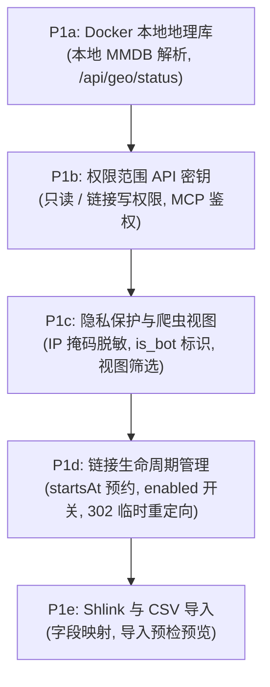

# 未来路线图与功能规划

本文档概述了 Sink 的战略路线图和功能规划。它定义了 Sink 如何吸收现代短链接管理平台（特别是 [Shlink](https://shlink.io)）中最具价值的功能特性，同时完整保留 Sink 的轻量、安全与简洁架构：既可无服务器运行于 Cloudflare（Workers、D1、KV、Analytics Engine），也可单容器自建运行于 Docker 主机（Node.js、SQLite）。

::: tip 产品设计原则：保持 Sink 轻量精简
Sink 致力于追求零运维负担。所有新增功能必须能够同时在 Cloudflare 边缘端和单机 Docker 环境中高效运行，坚决不引入外部消息队列（如 RabbitMQ、Redis Pub/Sub）或庞大的外部关系型数据库服务器。
:::

---

## 战略路线概述

Sink 的产品路线图分为三大核心方向：

1. **延续 Sink 现有优势：** 原生 Model Context Protocol (MCP) AI 工具支持、富样式的客户端二维码生成、PBKDF2 链接密码保护、社交分享卡片（OpenGraph）预览、标签分类、设备与国家智能跳转、点击 Webhook 以及零运维部署体验。
2. **第一阶段（权限、控制与隐私）：** Docker 本地地理位置解析、面向外部应用与 AI Agent 的权限范围 API 密钥、IP 脱敏与隐私控制、查询时区分爬虫/正常访客、计划启动与可暂停的链接生命周期、Shlink 及 CSV 导入适配器。
3. **第二阶段及后续（高级路由与深度治理）：** 有序多条件重定向规则引擎、失效访问（404）统计、标签重命名与清理治理、以及面向团队和多品牌的跨域名空间隔离。

---

## 坚持特性与非目标（边界划定）

在规划新功能前，Sink 明确了清晰的架构边界：

| 始终坚持的 Sink 特性                                                           | 明确排除的非目标（不采纳）                                                      |
| :----------------------------------------------------------------------------- | :------------------------------------------------------------------------------ |
| **Model Context Protocol (MCP)：** 原生支持 AI Agent 链接管理与查询            | **外部消息代理：** 不引入 RabbitMQ、Kafka、Redis 或 Mercure SSE 队列集群        |
| **客户端富样式二维码：** 基于 `qr-code-styling` 在前端即时渲染，不依赖后端绘图 | **重型数据库依赖：** 不引入 MySQL、MariaDB 或 PostgreSQL，专注维护 D1 与 SQLite |
| **边缘优先持久化：** Cloudflare D1 + KV 直读缓存，与本地 SQLite 保持一致性     | **邮件追踪像素：** 不开发 1 像素 `/track` GIF 统计接口（超出短链接核心范畴）    |
| **近实时轮询更新：** 10 秒定时采样队列平滑回放，取代脆弱易断的长连接服务       | **整站反向代理：** 仅保持单请求反代模式，不提供 HTML 静态资源改写与整站透传     |

---

## 功能对比与阶段规划矩阵

下表将 Sink 的能力与 Shlink 进行系统性对比，展示当前状态及目标实施阶段：

- **已具备：** Sink 当前代码已完整支持。
- **部分具备：** Sink 已实现部分功能，但尚有扩展空间。
- **规划中（差距）：** 属于既定计划，待分期落地实现。

| 功能模块            | Shlink 参考功能                           |             Sink 当前状态              |  目标阶段   | 落地细节与说明                                                                               |
| :------------------ | :---------------------------------------- | :------------------------------------: | :---------: | :------------------------------------------------------------------------------------------- |
| **核心短链**        | 自定义短码、增删改查、搜索、分页          | 已具备 |    保持     | 由 `shared/schemas/link.ts` 和 `/api/link/*` 完整支持。                                      |
| **API 密钥与权限**  | 多密钥管理、过期、吊销、只读/写入角色     |   规划中    | **阶段 1b** | Sink 目前使用统一站点管理员 Token 或 Cloudflare Access。规划引入只读与链接写入分级密钥。     |
| **时间与生命周期**  | 开始时间、结束时间、最大访问上限          |  部分具备   | **阶段 1d** | Sink 目前仅支持过期时间。规划支持 `startsAt` 预约发布与随时暂停/启用状态。                   |
| **隐私合规控制**    | IP 掩码脱敏、禁用 IP/UA/Referrer 采集     |   规划中    | **阶段 1c** | Sink 目前记录原始 IP 与 User-Agent。隐私功能将支持字段级开关及 CIDR 子网掩码脱敏。           |
| **爬虫访问分析**    | 标记爬虫、在查询端过滤爬虫数据            |  部分具备   | **阶段 1c** | 目前仅支持在入口丢弃爬虫。规划持久化存储 `is_bot` 标识并在控制台提供全量/仅人类/仅爬虫视图。 |
| **Docker 地理识别** | 内置 GeoLite2 离线数据库查询              | 已具备 | **阶段 1a** | 已在 `feat/standalone-docker` 分支实现，支持 MaxMind MMDB 离线库及定时原子热替换。           |
| **导入来源支持**    | 支持导入 Shlink、CSV、Bitly、YOURLS 等    |  部分具备   | **阶段 1e** | 目前支持 Sink 原生 JSON 导入。将补充 Shlink API/导出文件适配器与标准 CSV 批量导入解析。      |
| **高级跳转规则**    | 优先级规则：语言、参数、设备、地理位置    |  部分具备   | **阶段 2a** | 目前 Sink 支持独立的设备和国家跳转覆盖。后续将升级为按顺序匹配的多条件规程引擎。             |
| **标签操作与统计**  | 标签重命名、批量删除、标签维度统计        |  部分具备   | **阶段 2b** | Sink 目前支持标签分配与筛选，缺少标签批量修改/清理接口及标签维度的点击聚合报表。             |
| **失效链接跟踪**    | 记录 404 访问、不存在的短码或根路径请求   |   规划中    | **阶段 2b** | 目前只记录成功解析的链接。后续将引入定长循环队列记录异常请求，用于排查死链。                 |
| **回退重定向策略**  | 按未命中类型或按独立域名指定 Fallback     |  部分具备   | **阶段 2b** | 目前支持全局根路径跳转和 404 跳转。多域名落地后将补充按域名定制回退逻辑。                    |
| **多域名支持**      | 同一短码在不同独立域名下指向不同地址      |   规划中    | **阶段 3**  | 目前全局以 `slug` 为唯一主键。多域名支持需重构为 `(domain_id, slug)` 复合命名空间。          |
| **查询参数透传**    | 将访客携带的 `?…` 拼接到目标地址          | 已具备 |    保持     | 由 `redirectWithQuery` 链接属性直接提供。                                                    |
| **子路径转发**      | 短码后附加的子路径继续拼接到目标地址      |   规划中    |    后续     | 优先级较低；需完善路由冲突保护以防阻断后台接口。                                             |
| **多段短码**        | 支持带斜杠的多级短码（如 `/sale/autumn`） |   规划中    |    后续     | 需调整短码正则表达式，并严格预留系统核心路径（如 `/api/*`、`/dashboard/*`）。                |
| **实时更新推送**    | SSE (Mercure)、RabbitMQ、Redis 消息推送   |  部分具备   |    保持     | 维持现有 10 秒平滑回放轮询机制，避免为边缘节点增加复杂且昂贵的长连接基础设施。               |
| **二维码生成**      | 外部服务端专用二维码渲染 API 路由         | 已具备 |    保持     | Sink 现已在前端集成富样式二维码生成功能；Shlink 官方已于 v4.5 标记废弃服务端渲染接口。       |
| **邮件追踪像素**    | 提供 1 像素 `/track` 图片返回服务         |   规划中    |  **放弃**   | 明确不采纳。与短链接管理器的主航道脱节。                                                     |
| **外部统计对接**    | 自动将点击事件转发至外部 Matomo 服务      |   规划中    |    后续     | 推荐通过 Sink 现有的异步点击 Webhook 桥接外部数据系统。                                      |

---

## 分期实施规划

### 第一阶段：访问权限、隐私合规与链接控制 (P1)

第一阶段重点解决多应用接入安全、数据合规要求以及更具弹性的运营推广需求。

#### 1. Docker 本地 IP 地理位置解析 (P1a)

- **状态：** 已在 `feat/standalone-docker` 分支本地实现。
- **功能：** 为独立 Node.js/Docker 部署提供离线 GeoIP2/GeoLite2 City 与 Country 数据库解析，获得与 Cloudflare 边缘一致的地理重定向与热力图能力。
- **架构：** 在 `getRequestGeo(event)` 后封装 Node 专用解析适配器，利用持久化存储挂载数据库文件，并支持原子性安全热加载与 `/api/geo/status` 运维诊断端点。

#### 2. 面向外部应用与 AI Agent 的权限密钥 (P1b)

- **状态：** 计划中。
- **功能：** 在保留站点主管理员凭证的基础上，引入多组具有有效期与撤销机制的具名 API 密钥。
- **权限范围：**
  - `read:links`：只读浏览链接和搜索，无法进行修改。
  - `write:links`：创建、更新与删除短链。
  - `read:analytics`：拉取统计与报表数据。
- **安全保障：** 密钥采用 SHA-256 哈希安全存储。标准 REST 路由与 MCP Agent 服务共享统一的权限校验体系。

#### 3. 隐私合规选项与爬虫数据视图 (P1c)

- **状态：** 计划中。
- **功能：** 适配 GDPR/ePrivacy 隐私合规要求：
  - 支持配置是否记录客户端原始 IP、Referer 或 User-Agent。
  - 针对 IP 地址实施子网掩码脱敏（如脱敏 IPv4 末位字节或截断 IPv6 前缀）。
  - 使用带有时效性密钥的哈希计算独立访客指标，杜绝持久化存储个人可识别信息（PII）。
  - 在访问日志中记录明确的 `is_bot` 布尔标记，使仪表盘可自由切换“全部流量”、“真实用户”或“抓取爬虫”。

#### 4. 链接排期发布与随时暂停 (P1d)

- **状态：** 计划中。
- **功能：** 扩展链接的时间维度管理：
  - `startsAt`：设置未来生效时间，实现活动预约上线。
  - `enabled`：快速暂停与恢复链接重定向。
  - 生命周期状态细化：`生效中 (Active)`、`排期中 (Scheduled)`、`已暂停 (Paused)`、`已过期 (Expired)`。
  - 重定向规范：处于非永久状态或排期中的短链接统一使用非永久重定向状态码（`302` 或 `307`），避免客户端和 CDN 过早固化缓存。

#### 5. Shlink 及通用 CSV 导入适配器 (P1e)

- **状态：** 计划中。
- **功能：** 降低由其他系统迁移至 Sink 的门槛：
  - 针对 Shlink 的专有导入适配器，自动映射短码、目标网址、标签、标题、创建与过期时间。
  - 通用 CSV 批量导入工具，支持自定义表头字段对应规则。
  - 导入前交互式预检与试运行（Dry-run），提前提示格式错误、系统保留关键字及短码冲突行。

---

### 第二阶段：高级动态路由与深度治理 (P2)

第二阶段将强化路由分流规则与数据管理能力。

#### 1. 有序多条件重定向规则引擎 (P2a)

- **目标：** 将现有的独立设备与国家跳转升级为有序多条件流水线规则。
- **规则机制：**
  - 按用户设定的先后次序从上至下匹配，首条全部条件匹配成功的规则决定跳转目标。
  - 组合条件判断：支持匹配客户端首选语言（`Accept-Language`）、URL 查询参数（如 `utm_*`）、设备大类（iOS / Android / 桌面端）以及地理位置国家码。
  - 兜底逻辑：若所有规则均未命中，平滑回退至链接默认网址。
  - 向后兼容：保留老链接旧版设备/国家属性的既有跳转优先级，支持平滑显式升级。

#### 2. 失效链接跟踪与标签治理工具 (P2b)

- **目标：** 提升死链排查感知度与日常标签维护效率。
- **异常访问感知：**
  - 针对不存在的短码、已过期链接或异常请求，以固定容量循环日志进行记录。
  - 在管理端提供排错报表，协助运营人员定位投放链接拼写失误或异常探测行为。
- **标签治理工具：**
  - 提供全局批量重命名标签的接口与界面交互，同步更新关联链接。
  - 标签安全级联删除机制。
  - 标签维度的聚合统计与访问趋势对比。

---

### 第三阶段：多域名空间与多租户划分 (P3 - 远期)

第三阶段面向需要使用单套 Sink 实例管理多个独立品牌域名的企业级业务场景。

- **复合主键隔离：** 数据库及 KV 缓存主键由单一的 `slug` 升级为 `(domain_id, slug)` 复合命名空间。
- **域名管理面板：** 管理员可注册多个访问域名，并为各个域名单独设定主页与 404 回退地址。
- **域名权限绑定：** API 密钥与 Webhook 可按授权域名进行限定划分。
- **建议实践：** 在多域名原生复合隔离正式落地前，若需严格隔离不同业务线或品牌，建议部署相互独立的 Sink 子实例。

---

## 开发与验证规范要求

所有参与规划落地的代码改动均需严格恪守 Sink 的工程设计准则：

1. **双运行环境验证：** 必须在 Cloudflare Workers（D1、KV、Analytics Engine）和本地 Node.js/Docker（SQLite、本地卷）中同时通过功能与集成测试。
2. **增量数据库迁移：** 修改 `server/database/schema.ts` 中的 Drizzle 模型时，必须生成并提交前向兼容的无损迁移脚本至 `drizzle/`。
3. **统一数据持久化通道：** 链接的所有创建、修改与删除必须经过 `server/utils/link-store.ts`，确保 KV 直读缓存与底层数据库状态完全一致。
4. **前端设计规范：** 界面新增交互必须严格复用 `DESIGN.md` 与 Tailwind CSS 设计令牌，使用独立的 `*Form.vue` 与 `*Dialog.vue` 组件，表单优先依托 `@tanstack/vue-form` 与 `shadcn-vue` 构建。
5. **多语言词条对齐：** 新增任何功能配置、表单文案或统计维度时，必须同步更新 `i18n/locales/` 下包含的所有语言词条文件。
